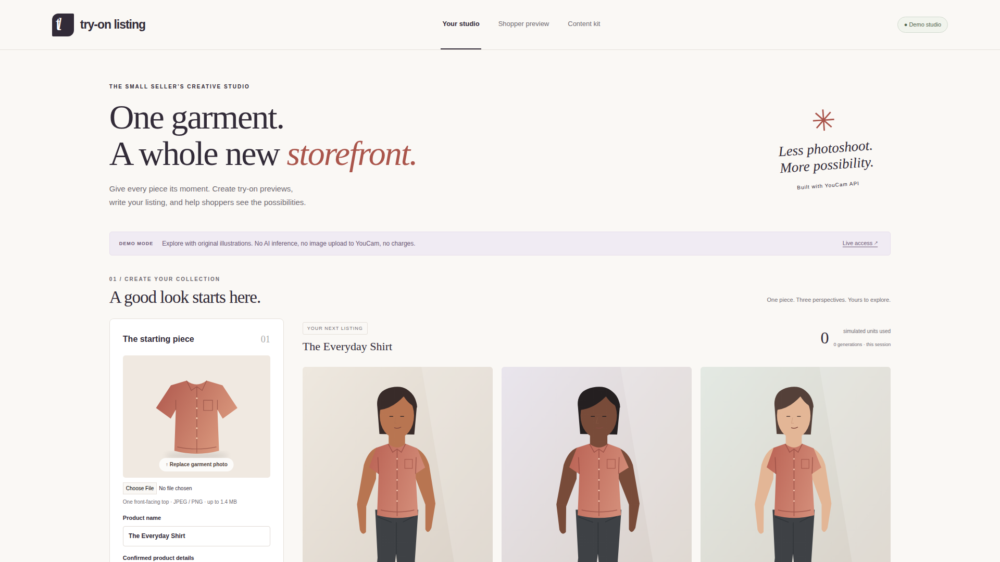
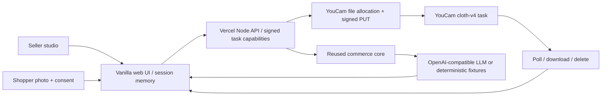

# Try-On Listing

**Turn one garment photo into virtual try-on previews, a thoughtful product page, and a shopper’s own-photo experience.**

For independent apparel sellers, a model shoot for every item is expensive. Flat product photos leave shoppers guessing about appearance and asking the same fit questions. Try-On Listing brings visual previews and fact-grounded content into a single small-seller studio.

Demo: [tryon-listing.vercel.app](https://tryon-listing.vercel.app). Source: [kks0488/tryon-listing](https://github.com/kks0488/tryon-listing).



## What it does

- Seller uploads a top and a model photo they have permission to use; offline mode offers three original illustrated silhouettes.
- YouCam Clothes VTO creates an appearance preview. A shopper can also provide their own photo with explicit permission.
- Product facts become a product page, styling suggestions, size-guidance questions, ad copy and a 32-second shorts script. JSON export is available.
- The studio tracks generation attempts and session units. Demo uses **2 simulated units per image, no charge**. Live pricing is queried from YouCam and normalized by `amount / proc_unit`; unknown pricing stays unknown. Session totals are published-rate estimates, not account balances or billing receipts.
- Changing source photos or facts invalidates old previews/content. Clear session removes local photos, generated images, content and the access code.

## Demo versus live

**The public deployment initially runs in offline demo mode. No real YouCam or LLM inference has been tested.** Original SVG illustrations are fixed scenario fixtures; they do not reproduce an uploaded person or garment. Every demo result is labeled. There are no real people, third-party photos, brand logos or scraped media in this repository.

With `YOUCAM_API_KEY`, YouCam mode switches automatically to live. With `LLM_API_KEY`, copy mode switches independently to live. Live requests require `STUDIO_ACCESS_TOKEN`, entered through **Live access** in the app, to protect provider units on a public deployment. There is no shared demo password in source. Without it, live calls are rejected. The prototype uses one seller workspace per browser session; it is not a multi-tenant marketplace, checkout system or durable product hosting platform.

Live mode needs **your own real garment and model/shopper JPEG or PNG**, each under 1.4 MB (a conservative Vercel request-size limit), at least 512 × 384 pixels, maximum side 4096 px. Use one unobstructed standing person and one front-facing upper-body garment. Demo illustrations are not valid live source photographs. Model choices offer different skin tones and silhouette illustrations; the app does not infer protected characteristics or body measurements.

## Sponsor integration

[Official Clothes VTO guide](https://docs.perfectcorp.com/reference/ai_clothes/section/overview/integration-guide) and [OpenAPI](https://docs.perfectcorp.com/_bundle/reference/ai_clothes.json?download), fetched with curl on October 16, 2026:

1. Server bearer-authenticates `POST https://yce-api-01.makeupar.com/s2s/v2.0/file` with `{files:[{content_type,file_name,file_size}]}` for each input. No additional API secret is required.
2. Server sends raw image bytes to the returned `data.files[].requests[]` signed PUT URLs with their supplied headers. API credentials are not forwarded to storage.
3. `POST /s2s/v2.0/task/cloth-v4` receives `{src_file_id,ref_file_id,garment_category:"upper_body",change_shoes:false,filter_multi_person:"strict"}` and returns `data.task_id`.
4. Browser polls our server about every 10 seconds; server queries `GET /task/cloth-v4/{id}`. Documented states are `running`, `success`, `error`; success contains `data.results.url`. Polling stops after about 6 minutes with a cleanup retry notice.
5. Server downloads the successful image into the response, then requests `POST /task/delete {task_id}`. The browser receives the image plus an accurate deletion outcome. The result URL itself is not exposed.

[Official unit-system schema](https://docs.perfectcorp.com/_bundle/reference/unit_system.json?download) is used for `GET /credit/feature-cost?page_size=20`, pagination via `starting_token`. Pricing retrieval is separate from paid task creation so it cannot delay delivery of the task token.

LLM requests reuse our MIT [Commerce Content Engine](https://github.com/kks0488/commerce-content-engine) message-building, input validation, parsing and OpenAI-compatible client, copied into `src/commerce.js`. The prompt treats product facts as untrusted data and marks missing facts. Defaults target [Nebius Token Factory’s documented endpoint](https://docs.tokenfactory.nebius.com/api-reference/introduction), `https://api.tokenfactory.nebius.com/v1/`. Set `LLM_MODEL` to an available model in your account. Another OpenAI-compatible endpoint, including Gemini’s compatible API with its appropriate model, can be configured via environment variables.

## Architecture



`public/` contains the UI and original vector assets; `src/youcam.js` handles sponsor calls; `src/listing.js` handles content generation; `api/index.js` is the same API used by local `server.js` and Vercel. There are no runtime npm dependencies, build pipeline, photo database, external fonts or analytics.

## Run and test

Node.js 22+:

```sh
npm test
npm start
# Open http://localhost:3000
```

For live configuration, copy `.env.example` to `.env`, fill in server-only values, then run `node --env-file=.env server.js`. Never put credentials into public JS or commits.

| Variable | Purpose |
| --- | --- |
| `YOUCAM_API_KEY` | Enables live YouCam VTO; owner supplies this |
| `STUDIO_ACCESS_TOKEN` | Required for paid live endpoints; owner chooses a private studio access code |
| `LLM_API_KEY` | Enables live copy generation |
| `LLM_BASE_URL` | OpenAI-compatible base URL; defaults to Nebius Token Factory |
| `LLM_MODEL` | Model available to your provider account; default target is `nvidia/NVIDIA-Nemotron-3-Nano-30B-A3B` |
| `PORT` | Optional local port; default 3000 |

On Vercel, set these through the project’s environment settings and redeploy; `.env` is not uploaded. The committed `vercel.json` serves `public/` and routes `/api/*` to the Node function.

Tests use Node’s built-in runner and mocked official response shapes. They cover file validation, signed upload flow, task creation/polling, response download before deletion, expired/tampered capabilities, access protection, pricing pagination, and demo/live content generation. GitHub Actions runs them on push and pull request.

Real browser captures are recorded **on pilot**, never on the low-memory Mac. Reuse its existing Playwright and Chromium (or install Playwright only on pilot):

```sh
# On pilot, with a temporary app server already running on port 3087:
PLAYWRIGHT_MODULE=/home/pilot/workspace/hackathons/qloo/node_modules/playwright/index.mjs \
CHROMIUM_EXECUTABLE=/home/pilot/.cache/ms-playwright/chromium-1228/chrome-linux64/chrome \
BASE_URL=http://127.0.0.1:3087 npm run capture
```

Verified: **15 Node tests pass**. The deployed demo passed desktop/mobile Playwright flows; additional intercepted live-mode UI checks verified permission payloads and authorization during cleanup without calling a real provider. Screenshots and browser results are in `media/`; desktop 1920 × 1080 and mobile 390 × 844. Captures exercise the real app in demo mode. Stop the temporary server afterward. These are source material for the shared Remotion kit, not the finished submission video.

## Privacy and practical limits

Photo inputs and results stay in application memory; the app writes neither to disk nor a database. HTTP bodies contain images only when generating. Server error responses omit provider bodies, credentials and signed URLs. We do not log images. Browser previews last until session clear or page close; downloading content exports text only.

In live mode YouCam receives images. Its [task-management API](https://docs.perfectcorp.com/_bundle/reference/task_management.json?download) supports deletion of finished tasks and associated inputs/outputs. Completed results trigger that request, with a retry control if it fails. Running tasks cannot be deleted. Closing the page, a network failure, an upload failure before task creation, or a process interruption can leave provider files/tasks behind. Keep the page open and retry deletion for interrupted tasks once they finish; task capabilities last 24 hours and are lost on page close. The app cannot promise immediate deletion in those cases. Provider retention beyond those APIs was not verified.

Virtual try-on predicts appearance, not physical size or fit. No inferred measurements or fit guarantees. Generated copy requires seller review; fabric, sizing, care, price and policies need confirmed facts. No claim that this prototype has reduced returns or improved conversion has been measured. Live photo quality, provider latency, real billing and model availability still require key-backed validation. Request timeouts are bounded for Vercel’s configured 60-second functions; interrupted requests remain a lifecycle risk.

## Hackathon submission requirements

Read with curl: [overview](https://youcam-api-skin-ai-ecommerce.devpost.com), [rules](https://youcam-api-skin-ai-ecommerce.devpost.com/rules), [resources](https://youcam-api-skin-ai-ecommerce.devpost.com/resources).

- Deadline: **November 2, 2026, 11:45 a.m. Eastern**. Build must be new or substantially improved during the September 29–November 2 submission period.
- Functional prototype using at least one YouCam API, with clear consumer or retail value. **Offline fixtures alone do not prove this requirement: obtain the key and verify live mode before submission.**
- English project description explaining features and value; source/assets/run instructions and license; freely accessible working demo/test access for judges.
- **Video required: public 1–3 minute end-to-end demo**, showing the app running and explaining YouCam use. Rules name YouTube (preferred) or Vimeo. Screenshots in this repository are not a substitute. The owner must provide/upload the final video URL.
- Judging: technical implementation, design, impact and quality of idea. Winners must participate in an exit interview.
- Resources describe a developer-account and manual redeem-code process for free units. The owner must create/login to their account and claim credits. No service registration or Devpost submission was performed.

## What was built during the hackathon

Built October 16, 2026: the Try-On Listing seller studio, original garment/model vector illustrations, schema-matched YouCam client, permission and session-clearing flows, task deletion and usage display, shopper preview, listing/content orchestration, Vercel API, automated tests, CI and browser captures. The commerce core pre-existed and is reused with its original MIT ownership; the try-on application and integration are new. No third-party source or media was copied.

## License

[MIT](LICENSE) — Copyright (c) 2026 Kyoungsoo Kim.
